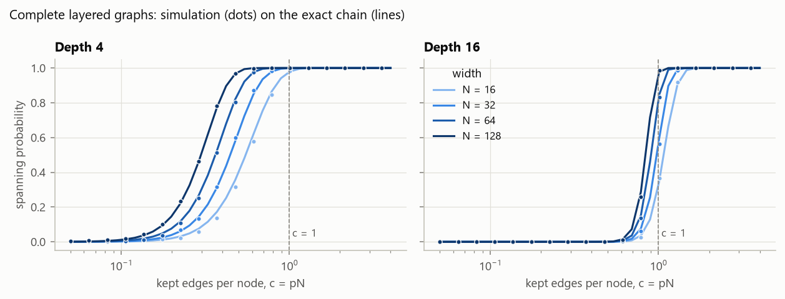
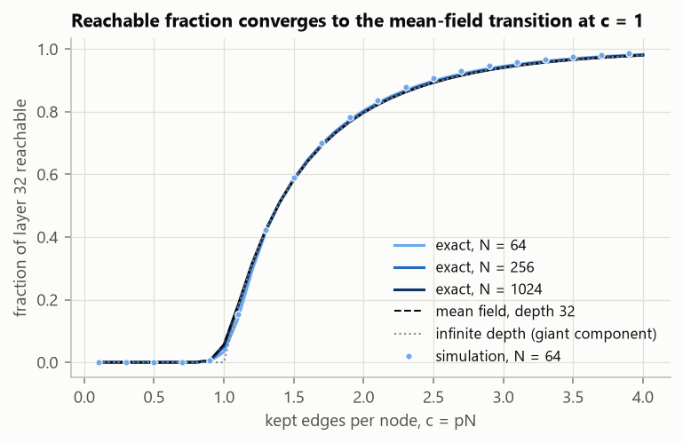
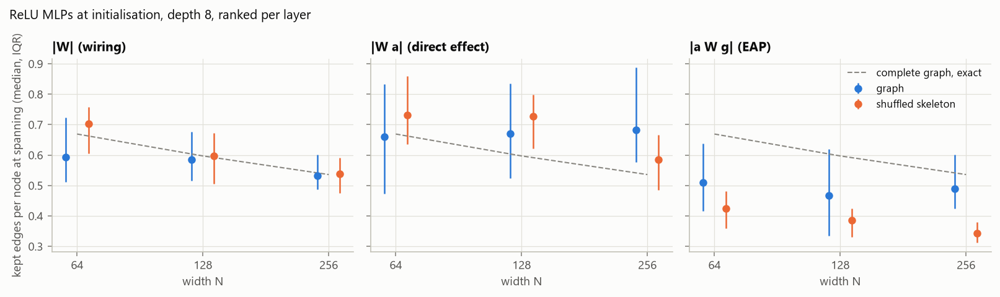
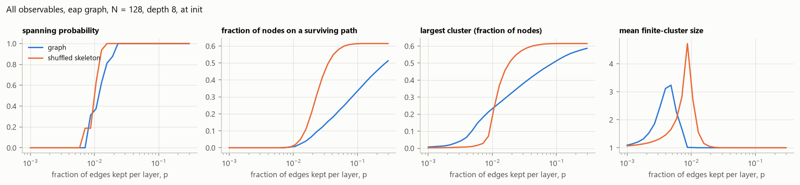

# Step 1: the control pipeline (e01)

Script: `experiments/e01_controls.py`, seed 0, 46 s on CPU. Raw numbers go to
`out/e01/results.json` (gitignored; rerun to regenerate). Figures are copied to
`docs/figures/e01/`.

The step answers two questions. Does the measurement code recover known answers?
And how far does an untrained network's influence graph already sit from plain
percolation? Step 2 has to subtract that gap before it credits anything to
training.

## Part A: known answers

Setting: complete layered graphs. Every node in a layer connects to every node in
the next, each edge is kept independently with probability p, all of layer 0 are
sources and the last layer are sinks. For this case `theory.reach_chain` is
exact: the number of reachable nodes per layer is a Markov chain with binomial
steps.

**A1: spanning probability.** 400 graphs per setting, 36 values of c = pN. In all 8
width × depth settings the simulation stays within 2.3 standard errors of the
exact curve at every point. **Pass.**

| depth | N | median c at spanning (sim) | exact | path count N^(-1/L) |
|---|---|---|---|---|
| 4 | 16 | 0.567 | 0.549 | 0.500 |
| 4 | 32 | 0.434 | 0.445 | 0.420 |
| 4 | 64 | 0.365 | 0.363 | 0.354 |
| 4 | 128 | 0.298 | 0.298 | 0.297 |
| 16 | 16 | 1.075 | 1.073 | 0.841 |
| 16 | 32 | 0.987 | 0.978 | 0.805 |
| 16 | 64 | 0.890 | 0.901 | 0.771 |
| 16 | 128 | 0.840 | 0.839 | 0.738 |

At finite depth the spanning point is not at c = 1:
- **Depth 4.** Spanning follows path counting, c* ≈ N^(-1/L), to within 3% from
  N = 64 on. It keeps falling as width grows.
- **Depth 16.** It starts near c = 1 and still drifts down with width.
- **Consequence.** The controlling variable is ln N / L. A width sweep of
  spanning at fixed depth therefore measures path counting, not a phase
  transition. Width scaling has to be run at several depths, or on a different
  observable (A2).

**A2: fraction of the last layer reachable** (depth 32).
- The exact curve converges to mean field as 1/N: the maximum gap is 0.044,
  0.0095 and 0.0022 at N = 64, 256 and 1024.
- At depth 32, mean field already lies on the infinite-depth giant-component
  curve, with its transition at c = 1. The simulation at N = 64 lies on the exact
  curve.
- Reachable fraction, and the backbone built from it, is the observable with a
  real transition at affordable depths. Spanning is not.

Fixed-count ranking matches Bernoulli for i.i.d. weights. The unit test
`test_rank_and_bernoulli_agree_for_iid_weights` checks this, and the |W| panel
below shows ranked Gaussian weights landing on the exact Bernoulli curve.

## Part B: ReLU MLPs at initialisation versus their shuffled skeletons

**Setup**
- **Networks.** 9 layers of width N (8 edge layers), Kaiming Gaussian init, no
  biases, Gaussian input, random readout vector as the task metric.
- **Samples.** 48 per setting, each a fresh network and a fresh input.
- **Three edge weightings.** |W| (wiring), |W a| (direct effect on the target's
  pre-activation), and |a W g| (edge attribution patching against a zero
  baseline).
- **Dead units.** Exact zeros from dead units are not edges. Per-input
  skeletons keep 56% of edges for direct effect and 31% for EAP.
- **Ranking.** Edges are ranked within each layer.
- **Null.** Weights are shuffled within each layer on the same skeleton, which
  is plain bond percolation on that skeleton.

**B1: kept edges per node at spanning** (median over 48)

| weighting | N | graph | shuffled | median p ratio | share spanning earlier than shuffle |
|---|---|---|---|---|---|
| \|W\| | 64 | 0.594 | 0.703 | 0.86 | 0.65 |
| \|W\| | 128 | 0.586 | 0.598 | 0.98 | 0.54 |
| \|W\| | 256 | 0.531 | 0.539 | 1.02 | 0.44 |
| direct | 64 | 0.661 | 0.732 | 0.89 | 0.67 |
| direct | 128 | 0.670 | 0.728 | 0.96 | 0.54 |
| direct | 256 | 0.682 | 0.584 | 1.23 | 0.27 |
| EAP | 64 | 0.511 | 0.425 | 1.31 | 0.27 |
| EAP | 128 | 0.467 | 0.386 | 1.18 | 0.33 |
| EAP | 256 | 0.490 | 0.343 | 1.51 | 0.10 |

- **|W| behaves as the null should.** It matches its shuffle and the exact
  complete-graph curve. The 0.86 at N = 64 is 31 of 48 samples, about 2
  standard errors from even.
- **EAP graphs span 18-51% later than their shuffled skeletons, and the gap
  grows with width.** At N = 256, 90% of samples span later.
  - Likely mechanism, not yet tested: an EAP edge is large only if its source
    is active (large a) and its target has a large gradient (large g). A node
    relays only if it has both, and nothing at init correlates the two. So the
    kept edges land on hubs that do not chain.
  - Check: measure the correlation of |a_v| with |g_v| across nodes.
- **Direct-effect graphs fall in between.**

**B4: all observables** (EAP, N = 128, 16 samples)

| | graph | shuffled skeleton |
|---|---|---|
| susceptibility peak (undirected clusters) | p = 0.0048 | p = 0.0087 |
| spanning probability reaches 0.5 | p = 0.013 | p = 0.011 |
| backbone reaches half its maximum | p = 0.076 | p = 0.023 |

- **Shuffled skeleton:** the undirected cluster transition and the directed
  spanning transition coincide.
- **Attribution graph:** they separate by about 2.7×. A star-shaped cluster
  forms early around hubs, but the backbone fills slowly.
- **Consequence:** largest component and spanning are not interchangeable on
  attribution graphs, even before any training. Report both.

**B2: per-input versus input-averaged graph** (same network, 48 inputs, N = 128)
- **Direct effect:** the averaged graph spans with 0.41 kept edges per node,
  against a per-input median of 0.69. That is at the 10th percentile of the
  per-input values.
- **EAP:** 0.20 against 0.42, at the 8th percentile.
- **Consequence:** the averaged graph looks about twice as well connected as
  the graph for a typical input. It does not stand in for per-prompt graphs.

**B3: one global threshold across layers.** The first layer has fan-in 32 against
128 elsewhere, so under Kaiming init its weights are twice as large. Ranking
globally then needs 1.76× as many kept edges to span as ranking within each
layer. Rank within layers, or normalise first.

## What step 2 must do because of this

1. **Credit training only with what the init gap does not explain.** Measure the
   trained graph's gap to its own shuffle, minus the same gap at init, or compare
   trained against init directly. At init, EAP graphs already sit 18-51% from
   their shuffle.
2. **Width scaling:** use the reachable or backbone fraction rather than
   spanning, or sweep depth as well as width.
3. **Report undirected clusters and the directed backbone separately.**
4. **Use per-prompt graphs as the ensemble.** Report the averaged graph as a
   separate object.

## Limits of this run

One depth for Part B (8), widths up to 256, 48 samples, one init scheme, no
biases, and zero-baseline EAP. The hub mechanism in B1 is a hypothesis.
