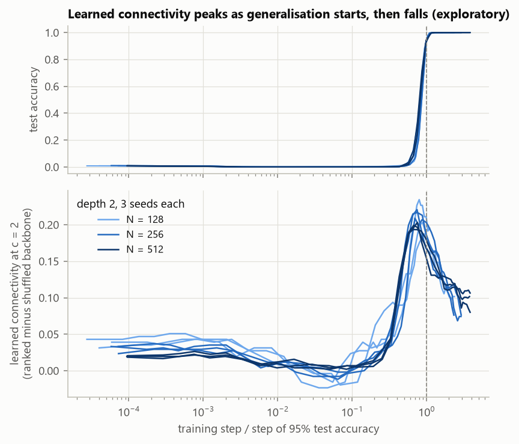
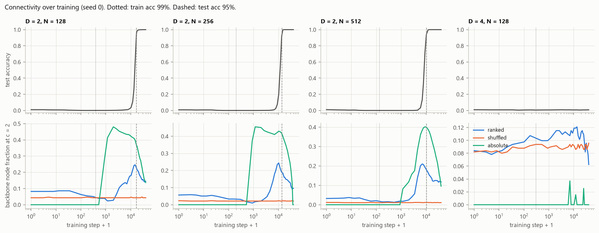
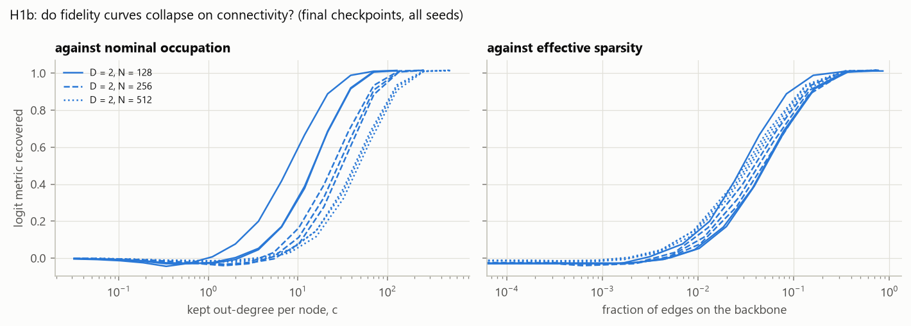
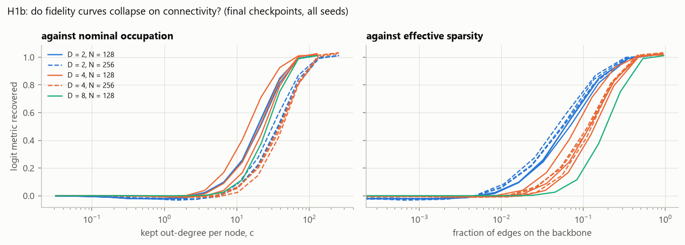
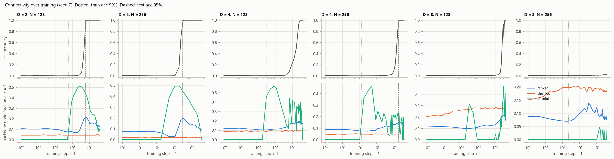

# Step 2: modular addition in deep MLPs (e02)

**Status (2026-10-11).**
- **Depth 2: complete.** Widths 128, 256 and 512, 3 seeds each; all 9 runs
  grokked.
- **Depth 4:** the one run trained (width 128) memorised but did not grok in 40k
  steps.
- **Depth 4 and 8 probes:** width-512 runs at both depths also failed to
  grok (final test accuracy 0.008). Depth 8 was unstable: train accuracy kept
  collapsing and recovering. Under the pre-registered hyperparameters, only
  depth 2 groks.

The depth sweep, and every claim that needs it, is still open.

- **Design and pass/fail criteria:** `plan.md`, "Step 2 design". They were
  written before any results, and so was every revision.
- **Scripts:** `e02_train.py`, `e02_analyze.py` (256 test inputs, 40
  checkpoints, EAP-IG with 8 steps), `e02_report.py` (scores the criteria) and
  `e02_diagnose.py` (exploratory follow-ups).
- **Occupation unit:** c, the mean kept out-degree per live source node.

## Pre-registered results

| Test | Criterion | Result | Verdict |
|---|---|---|---|
| H1a: dangling edges are inert | change in recovery < 0.05 wherever recovery is between 0.2 and 0.9 | 0.07-0.12 in every run, always in the same direction (backbone-only recovers more) | **fail** |
| H1b: fidelity collapses on connectivity | across widths, coefficient of variation of the half-recovery point: backbone edge fraction < nominal c | 0.11 vs 0.46 | **pass**, with a caveat below |
| H2: training moves the transition beyond init | Δ < 0 and \|Δ\| > seed spread | Δ > 0 in 8 of 9 runs; means per width +0.24, +0.40, +0.23 | **fail** |
| H3-rank | steepest change in learned connectivity between t_mem and 1.5 × t_grok | 8 of 9 runs | pass (weak test) |
| H3-abs | absolute-threshold curve tracks weight norm, Spearman ρ > 0.8 | 2 of 9 runs | **fail** |

Caveats on these verdicts:

- **H1b's pass does not discriminate.** Plain kept fraction (c/N) collapses just
  as well, with a coefficient of variation of 0.089; this check is exploratory.
  At a single depth, wider networks simply need proportionally more edges. The
  test cannot separate connectivity from that until depth varies.
- **H2 measures the wrong quantity.**
  - The spanning point c* moves in steps of 0.5, because the token layer has
    only two source nodes.
  - Most Δ values amount to c* moving from 1.0 to 1.5, a single rank step.
  - The sign is consistent (8 of 9 runs); the size is not meaningful.
  - This was knowable from the graph design before running, and I missed it.
    The depth arm should state a different H2 observable before it runs.
- **H3-rank's window is broad.** The shape of the curve, below, says more than
  the pass does.

## What the data show (exploratory, not pre-registered)

**1. Learned connectivity rises before generalisation, peaks as it starts, and
falls during cleanup.** "Learned connectivity" is the fraction of hidden nodes
on the backbone at c = 2, minus the same for the shuffled control. With time
measured in units of each run's grokking step (95% test accuracy), all 9 runs
fall on one curve:

| Phase | Learned connectivity |
|---|---|
| initialisation | +0.02 to +0.04 |
| memorisation and most of the plateau | about 0 to slightly negative |
| from about 0.2 × t_grok | sharp rise |
| peak, at 0.66-0.93 × t_grok | 0.19-0.23 at every width |
| after grokking (cleanup) | falls to +0.07-0.20 |

- **When the peak lands.** Test accuracy at the peak is 6-84%, median about 24%.
  So the peak marks the onset of generalisation, not its completion.
- **The shuffled control is flat throughout.**
- **The plan's guess about ranking was wrong.** It expected that removing
  memorising edges during cleanup would push circuit edges up the ranking, so
  connectivity would jump at cleanup. Instead, connectivity falls during cleanup.
- **Open question:** why the backbone at c = 2 shrinks after grokking. A
  candidate is that cleanup concentrates the circuit onto fewer neurons.
- **One non-grokking run as contrast.** The depth-4 run, which never grokked,
  never shows the rise (n = 1).

**2. Absolute thresholds track memorisation and the weight norm.** The
absolute-threshold backbone appears abruptly at memorisation (about step 1,000),
then collapses after grokking as weight decay shrinks the weights. Spearman's ρ
with the weight norm stays below the 0.8 criterion in 7 of 9 runs, because the
curve's shape differs across widths. At width 512 it rises through the plateau
instead of falling.

**3. The H1a gap comes from orphaned neurons.**
- **Where the dangling edges start.** At c = 8, more than 99% of kept edges that
  are not on the backbone start at a neuron the tokens cannot reach at that
  threshold.
- **They carry the whole gap.** Adding exactly those edges back to the backbone
  reproduces it: recovery goes from 0.310 to 0.208 at width 128, from 0.146 to
  0.043 at width 256, and from 0.130 to 0.043 at width 512.
- **Other dangling edges do nothing.** Edges ending at neurons that cannot reach
  the output have no effect.
- **Inactive neurons are not the cause.** Only 1-4% of dangling edges start at
  an inactive neuron, and adding them back changes recovery by under 0.01.
- **Leading hypothesis (untested).** Under mean ablation, a neuron whose inputs
  are all cut outputs relu(mean pre-activation), not its mean activation, so its
  kept out-edges inject an input-independent offset.
- **Practical consequence for mean-ablation circuit evaluation.** A thresholded
  subgraph contains orphaned nodes that bias the metric. Fix them at node level,
  by mean-ablating any node with no surviving inputs.
- **Using the backbone alone is not the fix.** At full occupation, the
  backbone-only subgraph recovers 1.13-1.19 of the full model's metric. It
  overshoots because inactive neurons get no attribution through a dead ReLU,
  so they can never join the backbone.

**4. Fidelity against occupation.** At depth 2, half recovery needs c of 8-15 at
width 128, 25-31 at width 256 and 43-48 at width 512. In every case that is
roughly 6-12% of edges kept per layer, and 3-5% of edges on the backbone.

## Next

1. **Depth arm.**
   - Run the queued probes (depth 4 and 8, width 512).
   - If they fail to grok, choose new hyperparameters on accuracy curves only,
     record them in the plan, then run the depth grid.
   - Before running it, state a replacement H2 observable: the backbone
     half-point, or reachable fraction instead of the spanning point.
   - Depth is what lets H1b separate connectivity from kept fraction.
2. **Test the orphan mechanism directly.** Compare an orphaned neuron's output
   with its mean. Then re-score fidelity with node-level ablation of orphans.
3. **Explain the cleanup decline.** Track how many distinct neurons carry the
   top-ranked edges over training.

## Depth arm (setting F)

Criteria: `plan.md`, "Depth arm", written before the search ran.

**Search.**
- Only setting F (Kaiming initialisation, training fraction 0.5) grokked at
  both depth 4 and depth 8.
- Kaiming alone, the larger training fraction alone, a lower learning rate
  and a smaller initialisation all stayed at chance.

**Grid** (widths 128 and 256, seeds 0-2):

| Depth | Grokked |
|---|---|
| 2 | 6 of 6 |
| 4 | 6 of 6 |
| 8 | 1 of 6 |

Depth 8 under setting F is seed-fragile. Non-grokked runs are excluded as
pre-registered, so 13 runs are scored.

| Criterion | Result | Verdict |
|---|---|---|
| H1a, dangling edges inert | gap up to 0.17 | **fail**, as at depth 2 |
| H1b (strict), fidelity collapses on backbone fraction better than on c and p | coefficient of variation 0.46 on the backbone axis, 0.30 on c, 0.14 on kept fraction p | **fail** |
| H2′, Δ′ < 0 beyond seed spread (confirmatory at depths 4 and 8) | depth 4: −0.30 ± 0.13 (width 128), −0.28 ± 0.04 (width 256); depth 8, one run: −0.52 | **pass** at depth 4; depth 8 untestable (n = 1) |
| H3-peak: peak in [0.5, 1.0] × t_grok, then a fall of at least 30% | 3 of 13 runs | **fail** |
| H3-rank / H3-abs | 6 of 13 / 6 of 13 | weak / fail |

**H2′ is the depth arm's positive result.**
- Training makes the graph's backbone reach 25% of hidden nodes with fewer
  kept edges than its shuffled control needs, relative to the same comparison
  at initialisation.
- That holds at every depth and width tested: Δ′ from −0.28 to −0.69.
- Depth 2 is exploratory, since its data were seen before H2′ was defined.
  Depth 4 is confirmatory.
- The spanning point (old H2) said the opposite, because it moved in coarse
  steps (see above).

**H1b fails for an instructive reason.**
- Against nominal c, the fidelity curves for different depths nearly coincide.
- Against backbone edge fraction, they fan out: deeper networks need a larger
  share of their edges on the backbone for the same fidelity.
- At a single depth (depth 2 above) the backbone axis looked good, but it does
  not transfer across depths.

**H3-peak fails on timing, not shape.**
- Under setting F the connectivity peak sits at the grokking step:
  0.7-1.7 × t_grok, mostly 0.9-1.2.
- The pre-registered window [0.5, 1.0] was taken from depth-2 runs under the
  old setting, where grokking came much later.
- At depth 4 the fall after the peak is smaller (16-38%).
- At depth 8 the ranked graph stays below its shuffle for most of training:
  the hub concentration seen in e03.
- Absolute thresholds become erratic at depths 4 and 8.
