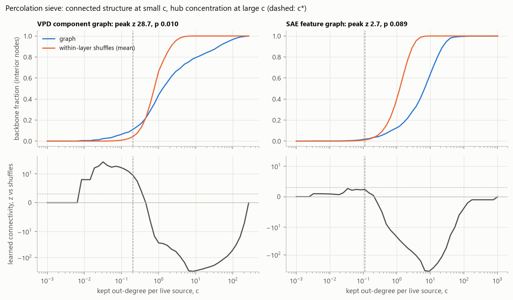
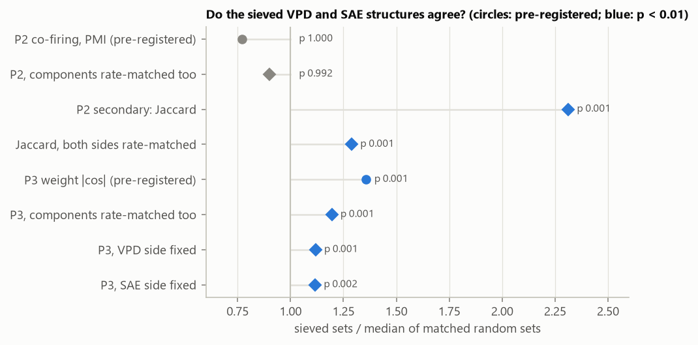
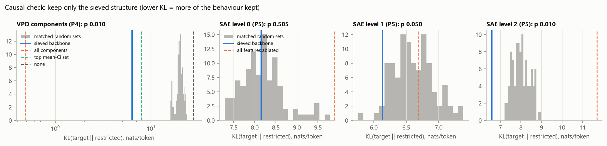

# e03 results: percolation sieve over a full VPD and an SAE tower

Design and predictions: `e03_design.md`, committed before any e03 model existed.
Revisions to it are recorded there and were made before any e03 data. Run
2026-10-11.

## What was built

- **Target model.** A 2-layer LlamaSimpleMLP (d = 128, about 1.4M parameters),
  trained offline on SimpleStories for 8k steps. Validation loss 2.455.
- **Full VPD.** Goodfire's param-decomp, run `p-ac82b80f`, 40k steps (the
  paper's 2-layer recipe used 400k).
  - Every module in both layers: q, k, v, o, MLP up, MLP down.
  - Delta component and the global shared-transformer causal-importance
    function.

  | VPD quality | Value |
  |---|---|
  | Faithfulness loss | 1.1e-6 |
  | Extra loss with only causally important components (CI-masked) | +0.36 nats (KL 0.48), recovering 98.7% of the zero-ablation gap |
  | KL with stochastic masks | 0.29 |
  | KL with random masks (reference) | 8.8 |
  | KL with everything ablated (reference) | 27.6 |
  | Active components per token | about 45 of 2,368 |
  | Alive components (CI > 0.1 on at least 1 in 10^5 tokens) | 1,566 |

- **VPD graph.**
  - Built from param-decomp's dataset attributions (`attr_abs`) over 819k
    tokens.
  - Nodes: 3,764 token nodes, the 1,566 alive components, and the output.
- **SAE tower.** TopK SAEs (1,024 latents, k = 16) on the residual stream at
  three levels. All 3,072 latents are alive.

  | Level | Fraction of variance unexplained | Loss with SAE spliced in (clean: 2.450) |
  |---|---|---|
  | 0 | 0.039 | 2.66 |
  | 1 | 0.076 | 2.65 |
  | 2 | 0.189 | 2.89 |

- **SAE graph.** Feature-to-feature gradient × activation edges over 65k
  tokens.
- **Cross-reference.** Per-token co-firing over 262k tokens, plus weight-space
  cosines.

## Pre-registered results

| Prediction | Result | Verdict |
|---|---|---|
| P1, VPD graph | peak z 28.7 against shuffle peaks up to 3.5; p = 0.010, the floor for 100 shuffles | **pass** |
| P1, SAE graph | peak z 2.7 against shuffle peaks up to 3.8; p = 0.089 | **fail** |
| P2, co-firing (best PMI) | sieved sets 0.77× the matched random sets; p = 1.0 | **fail** (opposite direction) |
| P3, weight directions (best \|cos\|) | sieved sets 1.36× the matched random sets; p = 0.001, the floor for 1,000 draws | **pass** |
| P4, causal: VPD backbone only (addendum, 2026-10-12) | KL 6.33 against matched random sets, median 20.2 and best 15.9; p = 0.010 | **pass** |
| P5, causal: SAE backbone only, per level (addendum) | passes at level 2 (p = 0.010), not at level 1 (p = 0.05) or level 0 (p = 0.5): 1 of 3 levels, 2 needed | **fail** |

- **Sieved structures.**
  - **VPD (c\* = 0.20):** 175 components (mostly MLP up/down and attention
    o), 315 tokens and the output.
  - **SAE:** none of its points reached z ≥ 3, so its c\* came from the
    fallback rule (raw peak at c\* = 0.11). It holds 78 features: 30, 19 and
    29 across the three levels.
- **Not a reading the design anticipated.** The design gave readings for both
  passing, only P2, or neither. P3 passing with P2 failing means the sieved
  structures point the same way in weight space but are not more specifically
  co-active than chance.

## What the data show (exploratory, not pre-registered)

**1. Both graphs have two regimes.**
- **At small c:** the sieve keeps more connected structure than the
  within-layer shuffles do.
  - VPD: z up to 18, at c ≈ 0.03-0.2.
  - SAE: only z ≈ 2.7.
- **At large c:** the graph is hub-concentrated. The top-ranked edges pile onto
  a few nodes, so the backbone covers far fewer nodes than the shuffles do
  (z down to about −300 for both graphs).
- e01 saw the same shape in untrained networks, so part of it is generic to
  attribution graphs.

**2. The SAE graph's null result depends on the control.**
- The shuffles above preserve each graph's layer-wise edge-weight distribution.
- Against controls that also keep each feature's strength (permuting each
  source's out-edges, or each target's in-edges), the SAE graph does show
  significant positive learned connectivity:
  - peak z 6.7 (out-strength kept) and 8.2 (in-strength kept);
  - p = 0.02, the floor for 50 shuffles.
- So the SAE tower has wiring structure, but frequency hubs mask it from the
  simple within-layer shuffle.
- **The VPD graph holds up against the same controls.** Its P1 pass survives
  both, with the same c\* and backbone:
  - peak z 44.0 with out-strength kept (shuffle maximum 9.3);
  - peak z 23.9 with in-strength kept (shuffle maximum 6.6).
- **The hubs sit on different sides.** VPD's large-c hub concentration
  disappears once out-strength is kept (z −1.2, from about −300), so it comes
  from a few components with very strong outgoing attributions. The SAE
  graph's hubs were on the receiving side.

**3. The P2 failure is not mainly about frequency, and the co-firing measures disagree.**
- **Frequency explains only part of it.** Sieved units fire far more often
  than average:
  - components: median rate 0.061 against 0.014 for all alive components;
  - features: 0.071 against 0.011.

  The design's random sets matched features on frequency but not components.
  Adding component matching moves P2 from 0.77 to 0.90 (still p = 0.99).
- **The design's secondary measure disagrees.** Jaccard overlap is enriched:
  2.31×, and still 1.29× with both sides frequency-matched (p = 0.001).
- **Reading:** the sieved VPD and SAE units fire on overlapping sets of tokens,
  but pairs among them are no more *specifically* associated (PMI) than pairs
  of similar frequency.

**4. P3 is robust.**
- It survives frequency matching on both sides: 1.20×, p = 0.001.
- Both sides carry it:
  - VPD backbone components align better with SAE features than random
    components do (1.12×, p = 0.002);
  - SAE backbone features align better with VPD components than random
    features do (1.12×, p = 0.001).

## Causal validation (addendum P4, P5)

Pre-registered on 2026-10-12, after P1-P3, before any causal run. Scored on
32k held-out tokens.

- **VPD (P4 passes).** Keep only the 175 sieved components (11% of the alive
  ones), switching the rest off per token through param-decomp's
  causal-importance masks:
  - KL to the full model falls from 27.6 (all components off) to 6.3;
  - 100 frequency-matched random sets of the same size only reach 15.9-24.6;
  - all components together give 0.48.

  Exploratory: the sieved set also beats the same-size set of each module's
  individually most important components (highest mean CI), 6.3 against 7.9.
  Choosing by connectivity adds something over choosing by importance.
- **SAE tower (P5 fails).** Keeping only the sieved features, with everything
  else in that level's SAE ablated:
  - level 2 beats every random set;
  - level 1 sits at the edge (p = 0.05);
  - level 0 is no better than random.

  This is consistent with P1 failing for the SAE graph under the
  pre-registered control.

## Replication (`e03_replication.md`)

Same target model, new SAE and VPD seeds (1 and 2), predictions written before
either seed ran.

| ID | Prediction | Seed 1 | Seed 2 | Verdict |
|---|---|---|---|---|
| R1 | VPD sieve significant: within-layer and in-strength controls | pass: peak z 27.1 / 32.5 | pass: 28.5 / 30.6 | **replicates** |
| R2 | SAE sieve significant against the in-strength control | pass: z 9.4 (shuffle max 3.4) | pass: z 6.6 (shuffle max 3.5) | **replicates** |
| R3a | Sieved sets align in weight space (P3) | pass: 1.22×, p = 0.001 | pass: 1.27×, p = 0.001 | **replicates** |
| R3b | Jaccard co-firing enriched, both sides frequency-matched | pass: 1.29×, p = 0.003 | pass: 1.25×, p = 0.004 | **replicates** |
| R4a | VPD backbone beats matched random sets causally (P4) | pass: KL 6.16 against best random 14.6 | pass: 5.73 against 15.7 | **replicates** |
| R4b | VPD backbone beats the top-mean-CI set | pass: 6.16 against 7.61 | pass: 5.73 against 8.10 | **replicates** |
| R5 | SAE backbone (in-strength sieve) beats random features in ≥ 2 of 3 levels | fail: p = 0.35, 0.12, 0.14 | fail: p = 0.40, 0.06, 0.05 | **does not replicate** |

**What holds across all three decompositions** (seed 0 and both replication
seeds):
- The percolation sieve finds connected structure in the VPD graph, and that
  structure survives every control.
- Keeping only those components preserves far more of the model's behaviour
  than size- and frequency-matched random components do: KL 5.7-6.3, against
  14.6-24.6 for random sets.
- It also preserves more than the same number of individually most important
  components (KL 7.6-8.1).
- The sieved VPD structure and the sieved SAE structure point the same way in
  weight space, and overlap in when they fire.

**What fails consistently:**
- The SAE graph's sieved structure carries no special causal weight.
- The SAE graph's connectivity is significant only once feature strengths are
  held fixed.
- Specific co-firing (PMI) between the sieved sets is below chance in every
  decomposition (0.76-0.78×).

## Caveats

- One tiny target, one seed, one SAE size. VPD ran for a tenth of the paper's
  steps: its CI-masked loss gap (0.36 nats) is usable but not tight.
- The SAE "sieved structure" used by P2 and P3 is the fallback backbone,
  because P1 failed for the SAE graph. It is the top-connected feature set, not
  a significant one under the pre-registered control.
- The two graphs come from different token counts (819k against 65k) and
  slightly different edge statistics. VPD uses param-decomp's |aggregate
  attribution to |target||; the SAE graph uses the summed per-token |·|, as
  pre-registered.
- Effect sizes for P3 are modest (1.1-1.4×). PMI and Jaccard disagree, so
  "agreement in usage" depends on the measure.

## Next

1. Done: VPD against strength-preserving controls (holds), and causal
   validation (VPD passes, SAE fails).
2. Rerun the SAE sieve and P5 with the strength-preserving control as the
   primary null. Pre-register it first, since it is now motivated by these
   results.
3. More seeds for target, SAEs and VPD, and a longer VPD run.
4. Port to a Qwen3-0.6B slice (one or two blocks) with a Qwen topology adapter.
