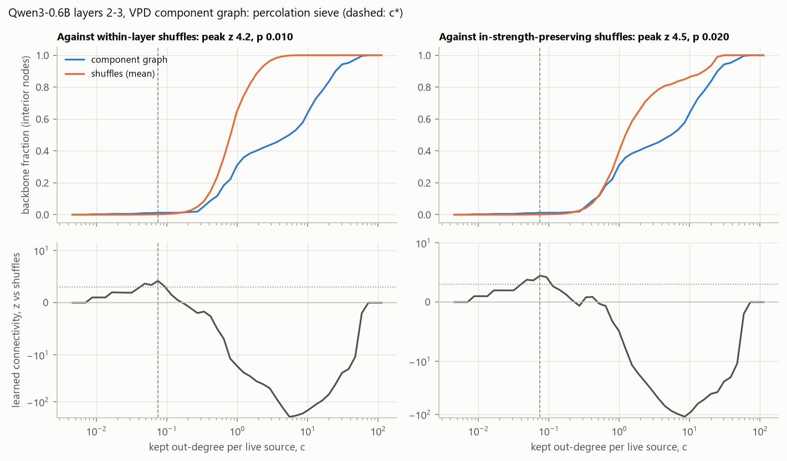
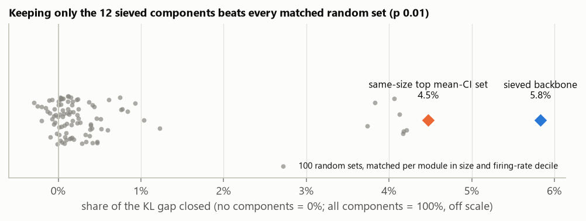

# e04 results: the percolation sieve on a Qwen3-0.6B slice

Design and predictions: `e04_design.md`, committed before the decomposition was
trained. Its revisions (the slice moved to layers 2-3; the held-out rows split
three ways) and the gate addendum were all made before any Q1-Q3 quantity
existed. Run 2026-10-18.

## Verdict

**Not transfer, by the pre-registered rule.**

| Test | Result | Pre-registered rule | Verdict |
|---|---|---|---|
| Quality gate | 7.7% of the gap unrecovered | at most 10% | pass |
| Q1, within-layer shuffles | peak z 4.2; the shuffles' own peaks reach at most 3.7 (p = 0.01) | beats all 100 | pass |
| Q1, in-strength-preserving shuffles | peak z 4.5; one shuffle of 100 reaches 7.3 (p = 0.02) | beats all 100 | **fail** |
| Q2, backbone vs matched random sets | KL 6.32; random sets 6.41 at best, median 6.66 (p = 0.01) | below all 100 | pass |
| Q3, backbone vs top mean-CI set | KL 6.32 vs 6.40 | below | pass |

- **Q1 fails, narrowly.** It needed both controls, and the in-strength control
  lost by one outlying shuffle. The next-highest shuffle peak is 3.93.
- **The design named "transfer" (all pass) and "partial" (Q1 passes, Q2 or Q3
  fails).** This run is neither: the connectivity test fails while the causal
  tests pass.
- **The structure the sieve finds is small and weak.** It is 12 components, 2%
  of the 599 alive, and lifts the backbone fraction by about 1 percentage point
  of interior nodes. On e03's toy model the same statistic reached z = 28.7;
  here it is 4.2.

## What ran

- **Decomposition.** Run `p-1ae4ebad`: VPD of layers 2 and 3 of Qwen3-0.6B,
  all seven projections each, 7,680 components, seed 0, 20,000 steps.
  - It was the third attempt. The first was killed by a Windows Update restart
    at step 3,689. The second hung at step 19,795 after a charger power flap
    wedged its CUDA context. Neither left a final checkpoint.
  - The third ran under a watchdog driver (`experiments/e04_pipeline.py`) and
    finished in 3 h 27 min without a restart.
- **Quality** (param-decomp's evaluation at step 20,000, `results/e04/gate.json`):

  | Masking | KL to the target (nats) | Share of the zero-ablation CE gap unrecovered |
  |---|---|---|
  | CI masks (the gate) | 0.63 | 7.7% |
  | Stochastic masks | 0.34 | 2.9% |
  | Random masks (reference) | 1.54 | 22.7% |
  | Slice zeroed (reference) | 6.56 | 100% |

  - The gate metric had stayed between 0.070 and 0.119 since step 2,000
    (`docs/figures/e04/gate.png`). The final reading was 0.077.
- **Firing statistics.** 102,400 held-out tokens.
  - 599 of 7,680 components are alive (CI > 0.1 on at least 1 in 10^5 tokens).
  - Queries are nearly unused: 2 alive in layer 2 and 6 in layer 3.
- **Graph.** param-decomp's attribution harvester on 102,400 different held-out
  tokens, edge statistic |attr_abs|.
  - 600 nodes (599 components and the output) and 57,967 edges.
  - The 180 sources are layer 2's alive q, k, v, gate and up components.
  - Attributions ran in batches of 16 rather than 4: the same 800 rows in the
    same order, in a third of the time.
- **Causal test.** 16,384 held-out tokens, disjoint from both of the above.
  KL(target ‖ restricted) is measured over the full vocabulary.

## Q1: connected structure



| Control | Peak z | Shuffle peaks: max / 99th percentile / median | Shuffles at or above the real peak | c* |
|---|---|---|---|---|
| Within-layer | 4.18 | 3.66 / 3.63 / 1.63 | 0 | 0.075 |
| In-strength | 4.46 | 7.30 / 3.96 / 1.61 | 1 | 0.075 |

- **Small c.** At small kept degree (c < 0.1) the graph connects slightly more
  interior nodes than its shuffles. This is the only region with positive
  learned connectivity.
- **Larger c.** From c ≈ 0.5 (within-layer) or c ≈ 0.8 (in-strength), the graph
  connects far fewer nodes than its shuffles. The lowest z is about −200
  (within-layer) and −110 (in-strength).
  - Attribution mass is concentrated on a few hub components, so the strongest
    edges keep returning to the same nodes.
  - e03's toy model showed the same split: connected structure at small c, hub
    concentration at large c.
- **Backbone.** Both sieves pick the same 12-component backbone at the same c*,
  all of it in layer 2:
  - attention: k[217], v[187], o[335];
  - MLP: gate[147, 203, 255], up[173, 488], down[121, 410, 539, 607].

  At this c the backbone is a shallow route: layer-2 components to the output,
  with no layer-3 component.

## Q2 and Q3: does the backbone carry behaviour?



| Set (mask = CI × membership; rest of the model intact) | Components | KL (nats/token) | Share of the gap closed |
|---|---|---|---|
| None of the slice | 0 | 6.664 | 0% |
| Matched random sets, median (100 sets) | 12 | 6.656 | 0.1% |
| Matched random sets, best | 12 | 6.413 | 4.2% |
| Top mean-CI set | 12 | 6.398 | 4.5% |
| **Sieved backbone** | 12 | **6.317** | **5.8%** |
| All components | 599 | 0.710 | 100% |

The share of the gap closed is (KL_none − KL_set) / (KL_none − KL_all).

- The backbone beats all 100 matched random sets (Q2) and the importance-ranked
  set of the same size (Q3).
- In absolute terms it carries little: 2% of the alive components close 5.8% of
  the gap.

## What the data show (exploratory, not pre-registered)

**One attention pair does most of the work.** The random sets split into two
groups: 93 near 0% and 7 near 4%. All 7 contain both L2 v[187] and L2 o[335].
Sets with only one of them stay near 0%.

A follow-up measurement on the same rows (`experiments/e04_explore_pair.py`,
`results/e04/explore_pair.json`):

| Set | Share of the gap closed |
|---|---|
| v[187] alone | 0.0% |
| o[335] alone | 0.0% |
| v[187] + o[335] | 4.0% |
| Backbone without the pair | 0.5% |
| Backbone | 5.8% |
| Top mean-CI set without the pair | 0.5% |
| Top mean-CI set | 4.5% |

- **The pair is the smallest unit that does anything.** An attention output
  needs both a value direction and an output direction, and either alone
  changes nothing.
- **The backbone's other 10 components work together with the pair.** Alone
  they close 0.5%. With the pair they add about 1.3 points beyond the sum
  (5.8% against 4.0 + 0.5).
  - The top-CI set's other components only add up: 4.5% ≈ 4.0 + 0.5.
  - So the backbone beats picking by importance (Q3) through MLP components
    that are connected to the attention route. That is what the sieve was
    designed to find.
- **The Q2 null is lenient here.** Random sets are matched module by module, so
  they rarely contain both halves of the pair (7 in 100). The backbone still
  beats the 7 that do (best 4.2%), but most of its margin over the median
  random set comes from containing the pair.

## Caveats

- **One decomposition seed.** The gate addendum pre-registers a seed-1
  replication under the same rules (R-Q1 to R-Q3). It has not run yet.
- **The p-value floor is 0.0099 with 100 shuffles or random sets.** Q1
  in-strength failed by exactly one shuffle. More shuffles would estimate that
  p-value better, but the rule as written is "beats all 100", and it did not.
- **The alive threshold depends on token count.** At 10^-5 over 102,400
  tokens, a component must fire at least twice to count as alive. The graph
  has 599 alive nodes; a smaller sample would have admitted more.
- **The slice was chosen for the size of its effect** (zero-ablation KL ≥ 1
  nat; `e04_design.md`). Layers 2-3 sit early in the network, so the result may
  not hold for the middle layers, where the first choice (13-14) barely
  mattered to the output.

## Next

- **Seed-1 replication**, pre-registered in the gate addendum. It needs about
  3.5 h of training and about 2 h for the later stages, under a 12-13 GB lease
  when the GPU is free:
  ```
  E04_SEED=1 E04_OUT=out/e04_seed1 E04_CONFIG=configs/e04/vpd_qwen3_0.6b_L2-3_seed1.yaml python experiments/e04_pipeline.py
  ```
  This runs with param-decomp's venv, on the fork's `feature/qwen3-topology`
  branch.
- **Q1 also asks for both controls, so the replication shows whether this
  near-miss was chance.**
