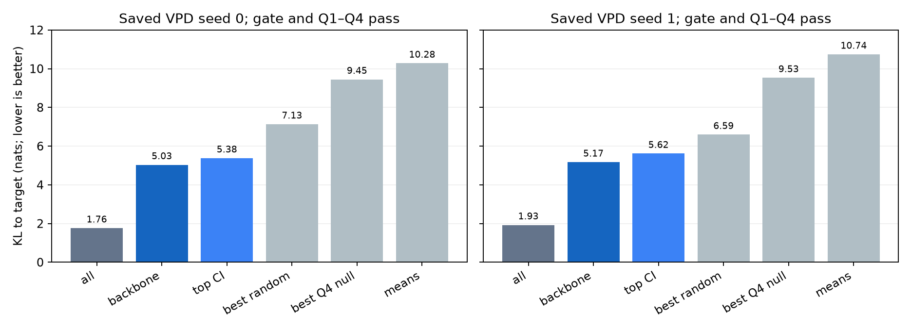

# e05b: the fixed transfer test passes in both saved decompositions

Completed locally on 2026-10-23 using the two batch-32, layers-0–1,
20,000-step VPD artifacts. Both seeds pass the quality gate and Q1–Q4.
This meets the operational transfer rule fixed in e05/e05b. It concerns
two decompositions of one Qwen3-0.6B target, not independent models.

## Fixed criteria and observed values

| Measure | Seed 0 | Seed 1 |
|---|---:|---:|
| Gate KL(CI-masked), limit 1.943471 | 1.763079, pass | 1.925512, pass |
| CI KL / PAMA KL, must be <=0.25 | 0.226795 | 0.247690 |
| Graph nodes / edges | 4,833 / 3,667,624 | 5,516 / 4,756,737 |
| Q1 within-layer peak z; corrected p | 18.945; 0.000999 | 17.650; 0.000999 |
| Q1 in-strength peak z; corrected p | 23.553; 0.000999 | 26.101; 0.000999 |
| Within-layer c*; kept components | 0.130675; 129 | 0.100096; 115 |
| Backbone KL | 5.032997 | 5.169791 |
| Q2 best of 100 rate-matched random-set KL | 7.133796 | 6.594039 |
| Q3 same-size top-mean-CI KL | 5.380879 | 5.615450 |
| Q4 best of 100 shuffled-backbone KL | 9.447894 | 9.530032 |
| All components KL | 1.763079 | 1.925512 |
| All components at position-class means KL | 10.279812 | 10.740461 |
| Backbone share of decomposition gap | 61.61% | 63.20% |
| Backbone components with >90% CI mass at position 0 | 30 | 23 |
| Q1 / Q2 / Q3 / Q4 | pass / pass / pass / pass | pass / pass / pass / pass |

KL is in nats; lower is better. The shared target baseline KL_PAMA is
7.773885, so its quarter is 1.943471. Seed 1 passes by about 0.01796 nats;
the gate was not changed to obtain this result. Q1 uses each of 1,000
null draws' own grid peak under both preregistered controls (p<=.01).
Q2 and Q4 require beating every one of 100 sets; their +1-corrected
empirical p-values are 1/101=0.009901 in both seeds. Q3 is the fixed
direct KL comparison, not a separately calibrated significance test.

Backbone gap share is (KL_none-KL_backbone)/(KL_none-KL_all), not a
fraction of all model behavior. Component counts exclude the virtual
output node (the sieve logs count that additional node). Position-zero
concentration is reported without a pass/fail criterion.

## Interpretation and limits

The selected small sets preserve more token-dependent behavior than
the specified random, importance and shuffled-backbone controls. The
companion e06 result shows why this should not be described as a special
wiring circuit: node-level alignment and degree/coverage structure
explain the graph statistic under those diagnostics. Functional set
selection and proof of paths beyond kept degrees are different claims.

No new language-model training was performed for this analysis. The
previous e05 batch-4 gate failures are a separate experiment; this is
the preregistered batch-32 fallback of e05b, not a post-hoc gate change.

## Provenance and recovery

Seed 0 is p-7e116244; seed 1 is p-06edd191. Both full run directories
and 2,528,576,999-byte final checkpoints remain saved locally. The
70-file manifest and final checkpoint SHA256s matched their paid-pod
originals. The pod was deleted at 2026-10-22 01:14 Singapore, with
successful API-list absence checks. Evidence: results/e05b_retrieval.json.

Each attribution harvest uses batch16 x50 (102,400 tokens). Stats also
use 102,400 tokens, and gates/causal tests use 16,384 evaluation tokens.
Seed 1's earlier save failed and left a truncated archive. The failed
file/logs were retained; only unfinished analysis was repeated. New
temporary-file/CRC/atomic-publication protection changes serialization,
not samples or scientific settings. The original I/O failure cause is
not independently established. Recovery: results/e05b_recovery.json.

Raw gate/sieve/causal JSONs: results/e05b/seed{0,1}_{gate,analysis,causal}.json.
Both complete attribution archives passed streaming ZIP CRC validation
at final review; their byte counts and SHA256s are recorded in
results/e05b/attribution_manifest.json. Large tensors and original logs
remain in out/e05b_seed{0,1}; no archive was discarded. The existing
87-test suite passed after the serialization fix; final review rechecked
all null/control counts, gates, causal outcomes and archive integrity.

