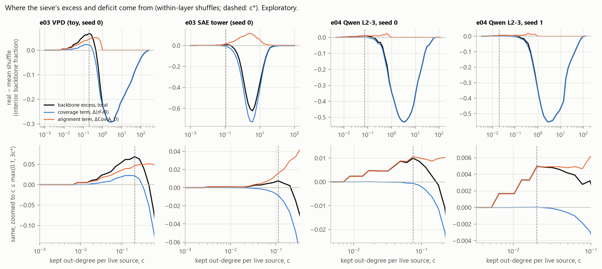
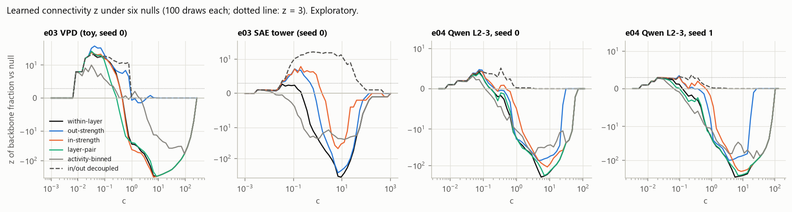

# e06 exploratory: what the sieve's z-curve is made of

**Exploratory. Nothing here is pre-registered.** Run 2026-10-21 on CPU, on graphs
that earlier experiments already analysed: e03 seed 0 (VPD and SAE graphs) and e04
seeds 0 and 1. These are discovery data. They motivated the e06 draft
(`e06_design.md`) and cannot confirm it.

- Code: `src/percinterp/diagnostics.py` (new; nothing existing changed) and
  `experiments/e06_explore.py`, `experiments/e06_report.py`.
- Results: `results/e06/explore_*.json`. Figures: `docs/figures/e06/`.
- Each null used 100 draws, so p-values have a floor of 1/101 ≈ 0.0099.

The questions came from a workshop with another AI: is the z-curve's sign reversal
core-periphery structure, and does the decomposition below separate the two regimes?

## Rebuilding the graphs

The graphs were rebuilt with `e03_analyze.vpd_graph` / `sae_graph` and
`e04_analyze.build_graph`, from the main checkout's `out/`. The within-layer sieve
was re-run with the original seeds. It reproduces the committed results exactly.

| Graph | Nodes / edges | Interior | Peak z (shuffle max) | c* | Most negative z (at c) |
|---|---|---|---|---|---|
| e03 VPD | 5,331 / 3.64M | 1,566 | 28.71 (3.54) | 0.204 | −339.8 (8.47) |
| e03 SAE | 3,072 / 2.10M | 1,024 | 2.68 (3.81) | 0.111 | −399.8 (9.21) |
| e04 seed 0 | 600 / 57,967 | 419 | 4.18 (3.66) | 0.075 | −208.2 (5.52) |
| e04 seed 1 | 874 / 113,554 | 599 | 2.96 (4.85) | 0.020 | −313.1 (5.55) |

No input was missing.

**A caution on the large-c z values.** At large c almost every shuffle puts almost
every node on the backbone. The shuffles' spread then sits at its floor (one node),
so z values of −200 to −400 mean raw deficits of 0.2-0.6 of interior nodes, not
anything 300 standard deviations deep. The raw numbers are given below.

## The two claims to check

**Claim 1: "e03 VPD's large-c deficit of about z = −300 shrinks to about −1.2 when
source out-strength is preserved."**

**Confirmed, for e03 VPD only.**

| Graph | Within-layer: min z (raw) | Out-strength kept: min z (raw) | In-strength kept: min z (raw) |
|---|---|---|---|
| e03 VPD | −339.8 (−0.293) | **−1.4 (−0.006)** at c = 2.24 | −358.4 (−0.298) |
| e03 SAE | −399.8 (−0.624) | −288.5 (−0.283) | −47.6 (−0.048) |
| e04 seed 0 | −208.2 (−0.530) | −73.4 (−0.189) | −110.0 (−0.332) |
| e04 seed 1 | −313.1 (−0.554) | −100.5 (−0.190) | −213.3 (−0.372) |

- The −1.2 in `e03_results.md` came from 50 shuffles (`results/e03/vpd_strength_nulls.json`:
  −1.23). With 100 shuffles it is −1.4.
- It does not generalise. On the Qwen slice, keeping out-strength removes about two
  thirds of the raw deficit, and keeping in-strength removes about a third. The Qwen
  graphs have hubs on both sides (see the decomposition below).

**Claim 2: "e03 SAE shows a significant positive excess under in-strength-preserving
shuffles."**

**Confirmed, with a caveat that matters.**

- With in-strength kept, the peak z is 7.81, above all 100 shuffle peaks (max 3.14),
  so p = 0.0099. `e03_results.md` reported 8.2 at p = 0.02 with 50 shuffles. The
  replications reported 9.4 and 6.6.
- With out-strength kept: 7.15 (shuffle max 3.75).
- **Caveat.** The excess disappears under an activity-binned null, which shuffles
  weights only among edges whose source and target fall in the same firing-rate
  quintiles: peak z 0.97, p = 0.92. The SAE graph's connectivity is explained by
  feature frequency. Its in/out strength correlation also falls from 0.85 to 0.43
  once firing rate is partialled out.

## Hypothesis 2: alignment at small c, coverage at large c

**The identity.** With A_v = 1[F(v) ≤ c] and D_v = 1[B(v) ≤ c], each layer's backbone
fraction is exactly

    b_l = r^F_l · r^B_l + Cov_l(A, D)

A test checks this to 1e-12, and checks that the node-weighted totals reproduce
`sieve()`'s curves. Below, "coverage" is the excess of Σ w_l r^F_l r^B_l over the
shuffles, and "alignment" is the excess of Σ w_l Cov_l. Together they add up to the
sieve's raw learned connectivity.

Against within-layer shuffles:

| Graph | At c*: total = coverage + alignment | At the most negative z: total = coverage + alignment | Large-c loss: r^F / r^B |
|---|---|---|---|
| e03 VPD | +0.069 = +0.022 + **0.047** | −0.217 = **−0.217** + 0.000 | +0.000 / **−0.217** |
| e03 SAE | +0.0075 = −0.0085 + **0.016** | −0.391 = **−0.454** + 0.063 | **−0.357** / −0.150 |
| e04 seed 0 | +0.0100 = −0.0006 + **0.0106** | −0.497 = **−0.497** + 0.000 | −0.171 / **−0.326** |
| e04 seed 1 | +0.0049 = +0.0000 + **0.0049** | −0.523 = **−0.523** + 0.000 | −0.150 / **−0.373** |

**Verdict: supported in all four graphs, with two qualifications.**

- **Small c.** The excess is alignment: the nodes reached from the sources are the
  nodes that reach the sink.
  - In e04 and the SAE graph, alignment is all of the excess or more.
  - In e03 VPD it is 68%. The rest is real coverage: at c*, more VPD nodes reach
    the sink than in the shuffles (r^B 0.172 against 0.120).
- **Large c.** The deficit is coverage. This is partly definitional: once every node
  is reached (r^F = 1, as in VPD), Cov is 0 whatever the structure. The informative
  part is which side loses coverage:
  - VPD loses it only on the sink side (r^B). That fits claim 1: hubs of strong
    outgoing attribution.
  - SAE loses it mostly on the source side (r^F). That fits the hubs being on the
    receiving side, as `e03_results.md` found.
  - Qwen loses it on both sides, with r^B the larger.
- **The coverage mechanism matches hypothesis 1.** At the most negative z, the share
  of interior nodes with at least one kept out-edge is:
  - VPD: 0.78, against 1.00 in the shuffles;
  - e04: 0.67 and 0.62, against 1.00.

  Uniform placement (N[1 − (1 − 1/N)^m] with the same edge count, ignoring the
  skeleton) predicts 0.94, 0.91 and 0.88. The real graph's top edges pile onto
  fewer nodes than either. At c*, the out-side coverage is also below the shuffles
  (VPD 0.18 against 0.29; e04 0.064 against 0.169), yet the backbone is larger. That
  is alignment winning over coverage.

## Is the backbone wiring, or a node-level property?

**The joint-degree null is degenerate on these graphs.**
- The null: binarise the kept edges at c, then make double-edge swaps within each
  (source layer, destination layer) block, keeping every node's kept in- and
  out-degree per block. 100 rewirings of 30 swap rounds each, onto skeleton edges
  only.
- It was run at each graph's c* and at c = 1 and c = 4. Those two values were fixed
  before any swap was run.
- **Why it is degenerate.** Nearly every interior node is on the backbone exactly
  when it has at least one kept in-edge and one kept out-edge:

| Graph | Share of interior nodes where "on the backbone" = "has a kept in- and out-edge": at c* / c = 1 / c = 4 |
|---|---|
| e03 VPD | 0.997 / 1.000 / 1.000 |
| e03 SAE | 1.000 / 1.000 / 1.000 (one interior layer, so this holds by construction) |
| e04 seed 0 | 0.995 / 1.000 / 1.000 |
| e04 seed 1 | 0.998 / 1.000 / 1.000 |

  The cause is the residual-stream skip edges. Every reader takes edges straight from
  the source layer, and every writer has an edge straight to the single output. A
  degree-preserving rewiring therefore leaves the backbone fraction unchanged.
  - The null's spread is exactly 0 in 11 of the 12 (graph, c) cells.
  - Coarser swaps (keeping only per-destination-layer degrees, or only total degrees)
    also have zero spread, except at the small-c cells. There, e04 seed 0 with only
    total degrees kept gives real 0.0119 against 0.0136 ± 0.0011, with the real value
    at the bottom of the null.
- **The one informative cell** is e03 VPD at c* = 0.204 (6,767 kept edges, swap
  acceptance 0.25):
  - real 0.1117 against null 0.1105 ± 0.0014 (range 0.1060-0.1137): z = +0.9,
    p (real ≤ null) = 0.25;
  - without the skeleton restriction the result is the same; with coarser blocks,
    p = 0.20 and 0.50.
  - **No wiring excess beyond the kept degrees.**

So on all four graphs the sieved backbone is, to within a few nodes, the set of
nodes with at least one top-ranked incoming edge and one top-ranked outgoing edge.
Who connects to whom adds nothing measurable.

**A null that does see the alignment: in/out decoupling.**
- It keeps every edge and weight. Within each layer it re-deals whole out-edge sets
  among the interior nodes, so each node keeps its inputs but gets another node's
  outputs.
- This keeps every rank, every strength sequence and the hub structure. It breaks
  only the pairing of a node's inputs with its outputs.
- Under it, the large-c deficit disappears (minimum z ≈ 0), and the small-c excess
  stays significant in all four graphs, including e04 seed 1, which failed the
  within-layer test:

| Graph | Peak z against decoupling (null max) | c of the peak |
|---|---|---|
| e03 VPD | 22.6 (8.2) | 0.35 |
| e03 SAE | 17.0 (4.1) | 2.84 |
| e04 seed 0 | 5.12 (3.98) | 0.42 |
| e04 seed 1 | 3.66 (3.03) | 0.24 |

The other weight nulls (peak z, shuffle maximum in brackets):

| Graph | Layer-pair | Activity-binned (rate quintiles of source and target) |
|---|---|---|
| e03 VPD | 29.4 (3.9) | 10.0 (3.7) |
| e03 SAE | (no skip edges, so the same as within-layer) | 0.97 (4.1), p = 0.92 |
| e04 seed 0 | 3.87 (3.31) | 3.14 (4.20), p = 0.06 |
| e04 seed 1 | 2.92 (3.44), p = 0.06 | 2.75 (4.39), p = 0.12 |

## Hypothesis 3: attribution creates correlated hubs

The measure is the Spearman correlation of each interior node's in-strength and
out-strength, ranked within its layer and then pooled.

| Graph | ρ(in, out) | One within-layer shuffle | ρ with firing rate partialled out | Top-10% share of out-strength: real / shuffle |
|---|---|---|---|---|
| e03 VPD | **+0.65** | −0.005 | **−0.02** | 0.64 / 0.33 |
| e03 SAE | **+0.85** | −0.055 | +0.43 | 0.38 / 0.13 |
| e04 seed 0 | **+0.37** | +0.000 | +0.13 | 0.69 / 0.46 |
| e04 seed 1 | **+0.26** | +0.018 | +0.08 | 0.68 / 0.46 |
| Untrained MLP, EAP (e01 setup, 9 × 128, 16 samples) | +0.05 ± 0.05 | | | 0.28 (uniform: 0.10) |

- **By module on Qwen** (seed 0 / seed 1):

  | Module | ρ |
  |---|---|
  | down_proj | +0.76 / +0.58 |
  | o_proj | +0.38 / +0.41 |
  | gate_proj | −0.06 / +0.35 |
  | up_proj | +0.17 / −0.10 |
  | k_proj | −0.27 / −0.41 |

  In e03 VPD every module type is positive (+0.39 to +0.68).
- **Verdict: partly supported.**
  - **Heterogeneous strengths:** yes. Even an untrained EAP graph puts 28% of
    out-strength on the top 10% of nodes. The trained graphs put 64-69% there
    (VPD and Qwen).
  - **Positive in/out correlation**, which is what feeds the alignment term: yes, in
    all four graphs. It is absent at initialisation (+0.05).
  - **But it is mostly firing frequency.** These are dataset-summed attributions, so
    a component that fires often has large total in- and out-attribution. With rate
    partialled out, ρ is −0.02 for VPD and +0.08-0.13 for Qwen.
  - The VPD backbone excess still survives the activity-binned null (z 10.0), so
    frequency explains VPD's strength correlation but not all of its alignment.

## Path length and stage coverage of the backbones

| Graph | Backbone at c* | Source-to-sink hops | Paths |
|---|---|---|---|
| e03 VPD | 175 components (91 in block 0, 84 in block 1), 315 tokens, output | 3 to 9 | 4,091 of 3 hops; 3.2M of 9 |
| e03 SAE | 30 / 19 / 29 features by level | 2 (by construction) | 233 |
| e04 seed 0 | 12 components, all layer 2 | 2 only | 10 |
| e04 seed 1 | 6 components, all layer 2 | 2 only | 4 |

- **Confirmed: both Qwen backbones are a shallow route.** A layer-2 reader feeds a
  layer-2 writer (o or down), which edges straight to the output. There is no
  layer-3 component and no path longer than 2 hops.
  - At c = 1 the e04 backbones reach layer 3 (200 and 249 nodes; hops 2-6). The
    largest group is layer 3's down_proj (46 and 98 components).
  - In e03 VPD the backbone uses both blocks, and most paths pass through both.

## What this changes

1. **The sieve's positive signal is node-level alignment**, not path structure.
   It amounts to: "nodes with a top-ranked input also have a top-ranked output".
   - On graphs with residual skip edges to a single sink, the backbone is a
     function of kept degrees, so no rewiring null can find wiring there.
   - In the toy VPD (the only cell where the joint-degree null had variance), there
     was none.
2. **The large-c "hub concentration" is coverage loss**, on whichever side the
   attribution hubs are. VPD: outgoing. SAE: incoming. Qwen: both.
3. **Frequency is a confound for the alignment.** It fully explains the SAE graph's
   excess, and VPD's strength correlation.
4. **For e06,** the joint-degree null cannot be the only primary null on these
   topologies. e05b's layer 0-1 slice has the same topology as e04, so the null
   would very likely be degenerate there too. See `e06_design.md`.

## Caveats

- These are discovery data, and many quantities were looked at. Treat every number
  here as hypothesis-generating.
- 100 draws per null. The z-scores of near-saturated nulls are floor-dominated.
- The init reference is an MLP EAP graph (e01's setup), not a decomposition of an
  untrained transformer. No such graph exists yet.
- Firing rates: VPD components from `crossref.pt`; tokens from
  `embed_token_count`; SAE from `sae_tower_eval.json`; Qwen from `stats.pt`. The
  output node is set to 1.
- Swap rounds propose disjoint swaps in parallel (30 rounds × E/2 attempts). The
  rewirings are well mixed in practice, but not an exact uniform sampler.
