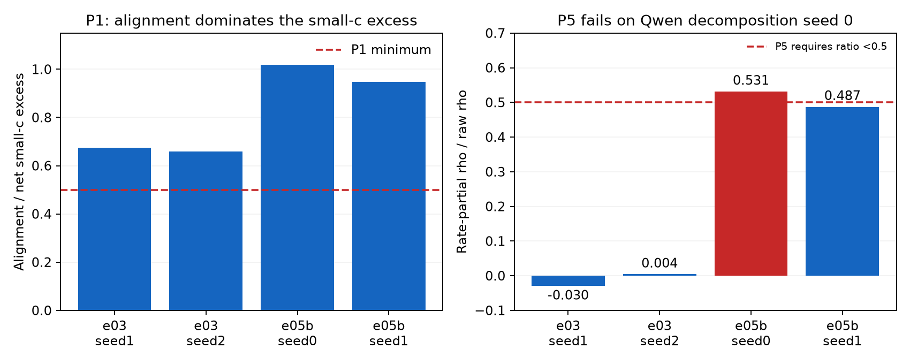

# e06: alignment and coverage explain the sieve signal; the rate-only rule fails

Completed 2026-10-23 under the unchanged preregistration. P1, P2 and P3
hold on all applicable held-out graphs. P4 meets its fixed rule: no
testable cell shows a wiring excess; e05b seed 0 is untestable. P5 fails
because e05b seed 0 retains more than half of its in/out correlation
after controlling firing rate.

## Every held-out graph and aggregate verdict

| Prediction | e03 seed 1 | e03 seed 2 | e05b seed 0 | e05b seed 1 | Across applicable graphs |
|---|---|---|---|---|---|
| P1 | pass | pass | pass | pass | holds |
| P2 | pass | pass | pass | pass | holds |
| P3 | pass (reported only) | pass (reported only) | pass | pass | holds |
| P4 | pass | pass | not testable | pass | holds |
| P5 | pass | pass | fail | pass | fails |

P3 counts only on the e05b graphs; toy-model large-c curves had already
been seen. Both e05b quality gates pass and are reported with their
graphs. These gates do not determine inclusion in e06.

## Fixed-c measurements

| Graph | P1 alignment / excess | P2 N-DC z; p | P3 N-WL z at c=4 | P5 rho -> rate-partial rho; ratio |
|---|---:|---:|---:|---:|
| e03_seed1 | 67.39% | 20.428; 0.000999 | -98.159 | 0.636397 -> -0.019111; -0.030030 |
| e03_seed2 | 65.80% | 21.323; 0.000999 | -98.497 | 0.634390 -> 0.002539; 0.004002 |
| e05b_seed0 | 101.88% | 20.634; 0.000999 | -228.290 | 0.249053 -> 0.132330; 0.531335 |
| e05b_seed1 | 94.82% | 20.829; 0.000999 | -277.256 | 0.227164 -> 0.110682; 0.487233 |

At c_s=.1, Qwen seed 0 has delta b=.016610, delta alignment=.016922
and delta coverage=-.000312; seed 1 has .015290=.014498+.000792.
Alignment can account for more than 100% of the net excess when coverage
opposes it. N-DC rejects chance pairing in every graph at p=1/1001.
The secondary grid-max N-DC tests also have p=1/1001 in all four graphs.

At c_L=4, Qwen backbone deficits are -.420989 and -.448187. Coverage
accounts for at least the entire deficit, with tiny positive alignment
terms (2.31e-8 and 1.41e-7). Most coverage loss is on the sink-reachability
side: delta rB=-.418624 and -.437556, versus delta rF=-.002365 and
-.010631. Toy-model P3 values are descriptive only.

## P4: limited evidence, not proof of absent wiring

| Graph | c=.1: testable, one-sided p | c=1: testable, one-sided p | Sampler |
|---|---|---|---|
| e03_seed1 | yes, 0.078921 | no, 1.000000 | parallel |
| e03_seed2 | yes, 0.072927 | no, 1.000000 | parallel |
| e05b_seed0 | no, 1.000000 | no, 1.000000 | sequential |
| e05b_seed1 | yes, 0.903097 | yes, 0.996004 | sequential |

The threshold is p<=.005 per cell after the fixed two-cell correction.
Both Qwen seed-0 cells have zero empirical spread and are untestable.
Seed-1 spread is small but nonzero (SD8.71e-5 and1.83e-5); its p-values
are .903097 and .996004. The real graph's degree-determined membership
share is 1.0 in every Qwen cell. Toy c=.1 shares are .995553 and .998104.
This design does not show wiring beyond kept degrees. An untestable
cell is not a positive empirical confirmation that no such wiring exists.

## P5 and the activity-binned control

All raw in/out correlations are positive with permutation p=1/1001.
The fixed reduction rule requires rate-partial rho/raw rho <.5.
Qwen seed 0 gives .531335 and therefore fails; seed 1 gives .487233
and passes. Both are close to the fixed boundary. It was neither moved
nor rounded to change a verdict. This is a failure of the universal
"mostly firing frequency" prediction; it does not by itself establish
a significant residual semantic alignment or identify its mechanism.

The reported-only activity-binned null N-AB at c=.1 gives p=.482517
and .479520 on the Qwen graphs (z=-.00272 and .05262). Thus those
data do not reject that stricter activity-conditioned control. N-DC
and N-AB condition different properties; their outcomes are compatible.
N-AB was not promoted to a preregistered success criterion after seeing
this result. The raw records retain the remaining null curves, anatomy,
coverage and degree diagnostics for inspection.

## Consequence for interpretation

The supported reading is node-level alignment plus coverage loss around
hubs. A within-layer sieve excess is insufficient evidence for special
wiring circuits, despite the e05b selected sets' causal usefulness.
The simpler claim that firing frequency explains most alignment on
every held-out graph fails its own fixed test. These graph diagnostics
do not assign semantic feature labels or measure polysemanticity.

## Reproduction and provenance

Each null uses 1,000 draws and the fixed seeds/c values in the design.
Qwen N-JD uses exact sequential swaps; toy results use the preregistered
parallel sampler, with the existing 200-draw sequential mixing check
reported in docs/e06_heldout_run.md. No extra draws were selected.
The two Qwen runs took 4,144 and 5,560 seconds, CPU only, under the
local resume driver's VRAMorama bookkeeping lease. Large graph/null
costs exceeded the initial design's Qwen runtime estimate; no sample
count changed to reduce cost.

Raw per-graph records: results/e06/heldout_{e03,e05b}_seed*.json.
Structured rescoring: results/e06/score.json; plain-text scores:
results/e06/final_score.txt. Undefined zero-spread z values become null
in the structured score export; original raw records are preserved.
Per-draw NPZs for the Qwen graphs are retained in out/e06_heldout and
copied into results/e06/e05b_seed{0,1}_draws.npz. E03 draw artifacts and
mixing checks were saved in the earlier held-out run.

The paid VPD artifact copies and pod deletion were verified previously
(results/e05b_retrieval.json); this remaining analysis used local compute.
The final review reapplied the existing scorer to all four records and
checked all 1,000-draw settings. The 87-test suite passed after the only
implementation fix, atomic attribution publication. No preregistered
gate, threshold, seed or score rule was changed.

