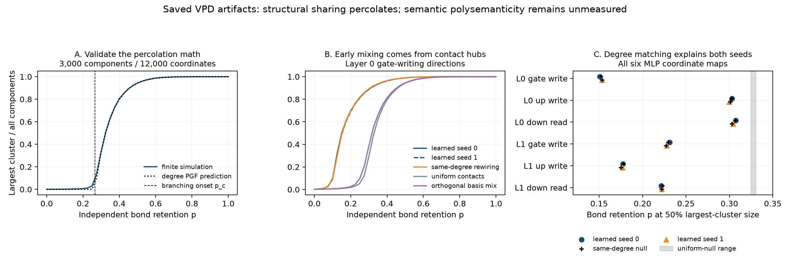

# VPD neuron sharing: percolation is largely explained by contact degrees

Exploratory study completed 2026-10-22 on the two saved Qwen3-0.6B VPD
decompositions. No new training or rented compute was used. This study concerns
static component/neuron sharing; **semantic polysemanticity was not measured**.



## What was measured

Each decomposition supplies 768 rank-one subcomponents per MLP weight matrix.
For layers 0 and 1, we separately analyzed gate-writing directions, up-writing
directions and down-reading directions in the same 3,072-neuron MLP coordinate
space. Both seeds therefore give 12 maps and 9,216 direction rows in total.
No zero rows were excluded. The target model is shared between seeds: these
are two decomposition seeds, not two independently trained language models.

For each direction, squared coordinates were normalized to unit energy. We
connected a component to its eight largest-energy coordinates, then retained
each graph edge independently with probability p. The largest cluster was
measured as a fraction of all component vertices. A sweep of top-k supports
used k=1,2,3,4,6,8,12,16. The fixed design used 32 bond-percolation draws,
41 occupation points and eight null draws per k-sweep point.

Controls were uniform coordinate contacts, configuration rewiring preserving
both degree sequences, and an orthogonal coordinate mix preserving direction
inner products. This follows the component parameterization in the
[VPD paper](https://arxiv.org/html/2610.20748v1#S2.SS1), with a graph definition
and measurements introduced here. The complete protocol and derivation are
in `docs/e07_design.md` and `docs/e07_math.md`.

## Result 1: concentrated coordinate contacts make the graph mix earlier

The table gives p at which the **mean** largest cluster reaches 50% of
components. Values are interpolated on the fixed 0.025 grid. This crossover
is a descriptive finite-graph quantity, not the critical percolation point.

| Coordinate map | Learned, seeds 0 / 1 | Same-degree null, seeds 0 / 1 | Uniform null, seeds 0 / 1 |
|---|---:|---:|---:|
| Layer 0 gate write | 0.151 / 0.153 | 0.152 / 0.153 | 0.326 / 0.331 |
| Layer 0 up write | 0.303 / 0.300 | 0.303 / 0.301 | 0.326 / 0.329 |
| Layer 0 down read | 0.307 / 0.305 | 0.307 / 0.303 | 0.326 / 0.328 |
| Layer 1 gate write | 0.231 / 0.228 | 0.230 / 0.227 | 0.325 / 0.325 |
| Layer 1 up write | 0.177 / 0.177 | 0.178 / 0.175 | 0.327 / 0.327 |
| Layer 1 down read | 0.222 / 0.222 | 0.223 / 0.222 | 0.328 / 0.326 |

Layer 0 gate-writing directions show the largest shift: the 50% crossover
is near 0.15 rather than 0.33. The orthogonal coordinate mix moves it to
0.314 and 0.321 while preserving sampled row-Gram entries to within 8.9e-16.
That identifies dependence on the physical coordinate basis, rather than on
pairwise direction angles alone. Rotating this geometry is not claimed to be
a function-preserving operation on a nonlinear MLP.

The role-dependent crossover pattern is similar across the two decomposition
seeds (Pearson r=0.9997 across six role/layer pairs). This is descriptive
replication within one target model, not a population estimate.

## Result 2: degree-preserving rewiring closely reproduces the shift

Across all 12 maps, the learned and same-degree mean curves differ by at most
0.0243 in largest-cluster fraction on the measured grid. Their 50% crossover
differences are at most 0.00197; their integrated-curve differences have
absolute value at most 0.00114.

These are descriptive effect sizes. There was no discovery significance
test or multiple-comparison decision rule. Close curves do not prove that
all higher-order structure is absent. The configuration null permits parallel
contacts, with mean duplicate fractions ranging from approximately 0.14% to
0.87%; this finite multigraph difference also limits the comparison.

The practical inference is that degree concentration accounts for most of
the observed early structural mixing under this diagnostic. A sharp
percolation curve alone would be weak evidence for a semantic community or
a special circuit of paths.

## Result 3: the branching model provides a useful mathematical baseline

For a sparse locally tree-like bipartite configuration ensemble, define

    kappa_C = E[D_C(D_C-1)] / E[D_C]
    kappa_N = E[D_N(D_N-1)] / E[D_N]
    B(p) = p^2 * kappa_C * kappa_N
    p_c = 1 / sqrt(kappa_C * kappa_N).

The two-type generating-function framework is based on
[Newman, Strogatz and Watts](https://arxiv.org/html/cond-mat/0007235v2#S4).
Here the extension to independent bond retention requires both edges of a
two-step continuation to survive. The degree-only critical point predicts
the onset of a giant component in the ensemble limit; it is not p at which
a finite graph's largest cluster reaches 50%.

For uniform contacts with C=768, N=3,072 and k contacts per component,

    E[B(1)] = (k-1)(C-1)k/N.

This puts k=2 below the generic branching threshold and k=3 above it. In the
learned maps, the first measured k reaching a 50% cluster is 2 for gate
writers and both layer-1 up/down maps, versus 3 for the layer-0 up/down maps,
in both seeds. Again, these are finite 50%-cluster crossovers.

The learned degree distributions imply k=8 bond onsets between 0.0963 and
0.2466. The full probability-generating-function predictions approximate
their same-degree Monte Carlo curves, with maximum grid discrepancies
0.0409–0.0619, concentrated near the finite transition. We did not fit those
thresholds to the measured cluster curves.

A separate random-support calibration with 3,000 components and 12,000
coordinates had maximum prediction error 0.00374 for p>=0.4. Unit tests also
compare the incremental simulator against independent sparse connected-
component calculations, verify exact regular-bipartite fixed points, and
exercise the macroscopic-star counterexample where naive branching logic
is inapplicable.

## What this says about polysemanticity

The connection to polysemanticity is a hypothesis about shared coordinates:
if distinct semantic features share neurons, their component/neuron contact
graph can connect them into mixing regions. The relation between sparse
features, shared representations and polysemantic neurons motivates this
interpretation in [Toy Models of Superposition](https://arxiv.org/abs/2209.10652).
This artifact alone does not supply those feature labels.

Three limitations are decisive:

- **The graph sees a thin energy tail.** The eight selected contacts retain
  only 2.72–3.64% of the median direction's squared energy across the maps.
  Its occupation p is graph-edge retention, not a fraction of model energy
  or a causal ablation of the language model.
- **Participation counts are geometric.** Median effective components per
  coordinate are about 259–264 after giving every component unit energy.
  These are not counts of independent meanings. Dense isotropic directions
  can also give large participation ratios.
- **Activity and meaning are unobserved here.** The study includes all
  subcomponents, without filtering by CI firing, output importance, token
  contexts, activation covariance or signed cancellation. The full-rank delta
  component is omitted. Nominally 768 subcomponents in 3,072 coordinates is
  not an overcomplete feature count in an individual role.

Thus the supported conclusion is **structural sharing dominated by degree
heterogeneity**, not evidence that these neurons encode a measured number
of unrelated concepts.

## Concrete candidates for the semantic follow-up

The top-contact coordinates include neuron 196 for layer-0 gate writers
(68 and 61 top-eight component contacts in seeds 0 and 1), and neuron 33 for
layer-1 gate writers (48 and 71 contacts). Layer-1 up coordinate 1037 has
53 contacts in each seed. Component IDs themselves are not aligned across
decomposition seeds.

A subsequent study could freeze these candidates, collect their token
contexts and signed CI-weighted contributions, test for distinct contextual
families while controlling firing rate and position, then intervene on the
proposed component/context pairs. That would connect the structural graph to
actual semantic polysemanticity. It has not been performed in e07.

## Provenance, verification and artifacts

Final checkpoints: seed 0 `p-7e116244`, seed 1 `p-06edd191`, each 2,528,576,999
bytes. Their local SHA-256s were matched to the original paid-pod files before
analysis; evidence is in `results/e05b_retrieval.json`. Both original full run
directories remain saved. The paid pod was deleted and is not needed again.

The CPU computation took 119.9 seconds. A constrained reader mapped only the
needed float32 factor arrays, without importing PyTorch or allocating GPU
memory. An OS-enforced 512 MiB process-commit limit remained active; measured
peak before figure generation was 265.5 MiB. The pre-existing GPU harvest
continued with its VRAMorama protections unchanged. This execution change did
not alter the fixed scientific protocol.

All 70 tests pass, including compatibility checks against torch.save shared,
transposed and offset tensor views. Both figures were visually inspected.
The existing e05b/e06 causal and attribution studies remain separate and were
not re-scored or modified by this exploratory result.

- Raw measurements: `results/e07/geometry.json`.
- Overview figure: `results/e07/overview.png`.
- All 12 percolation curves: `results/e07/curves.png`.
- Definitions/implementation: `src/percinterp/polysemanticity.py`.
- Reproduction driver: `experiments/e07_geometry.py`.

In a configured local checkout with the saved inputs, reproduce into a fresh
scratch directory without overwriting the recorded result:

```powershell
.\.venv\Scripts\python.exe experiments\e07_geometry.py --results-dir out\e07_reproduction --figure out\e07_reproduction\curves.png --overview out\e07_reproduction\overview.png
```

The runner refuses to replace an existing completed geometry JSON. A new
scratch directory is required for another reproduction.
